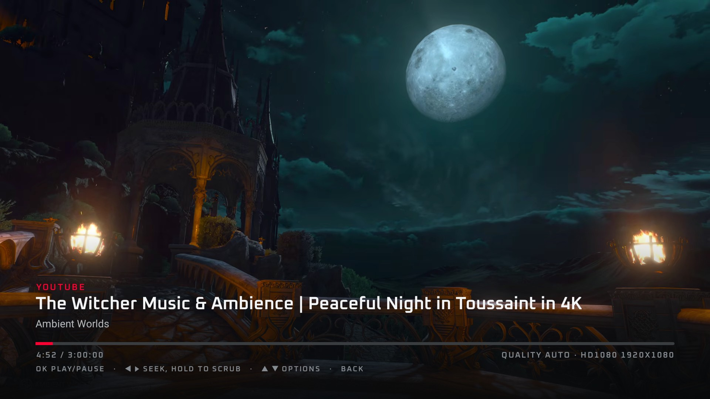
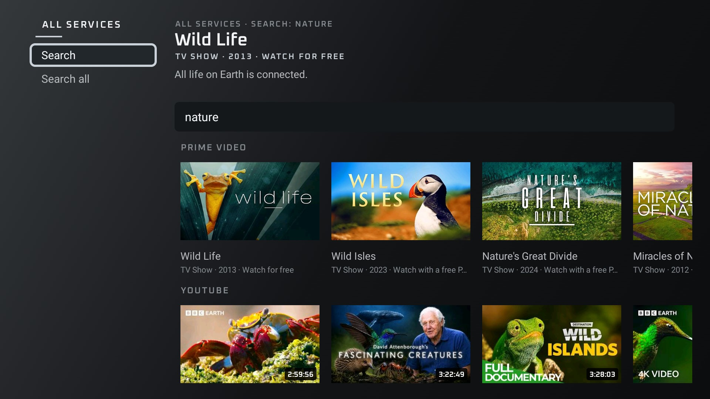
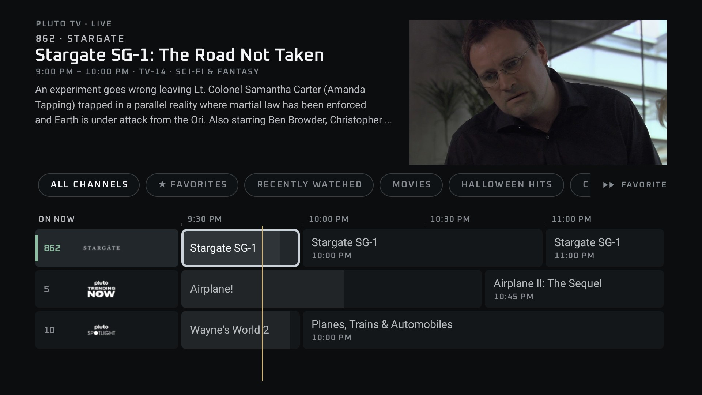
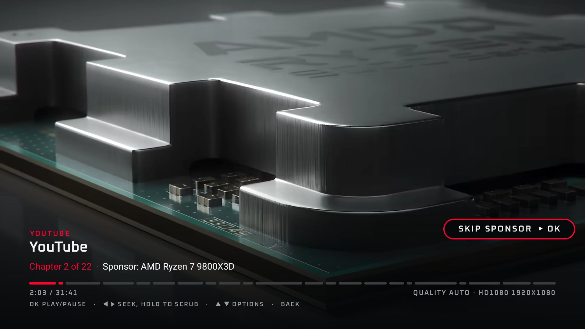
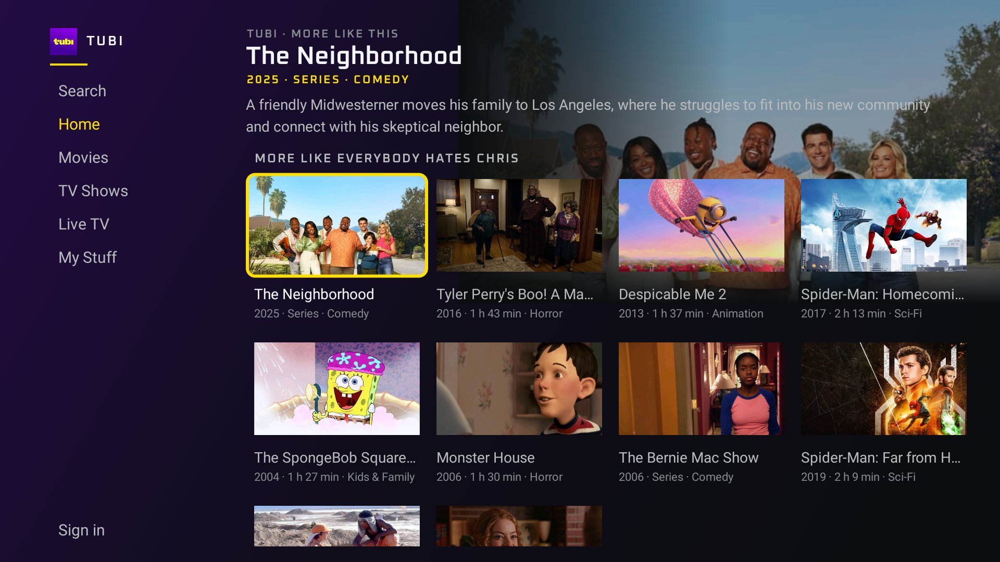
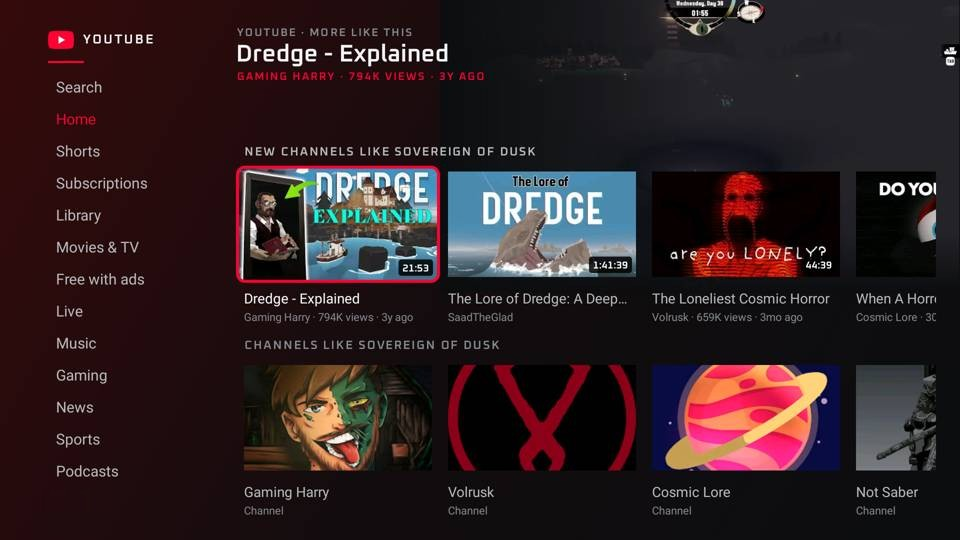
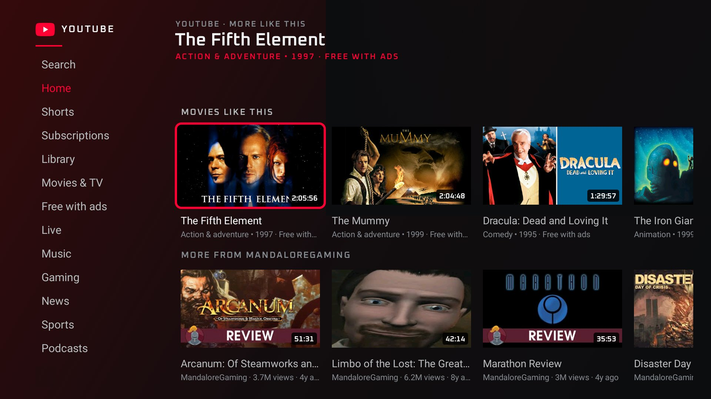
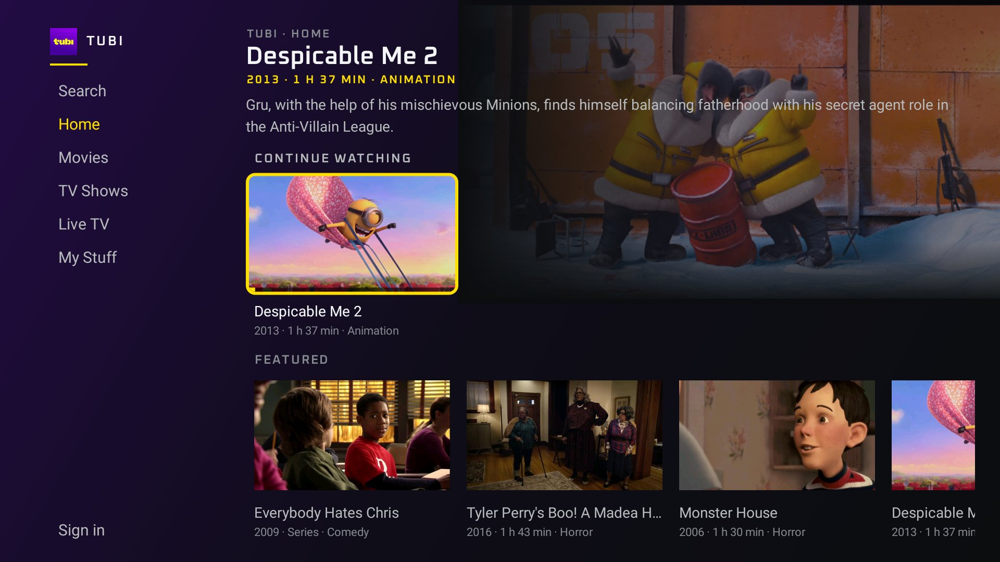
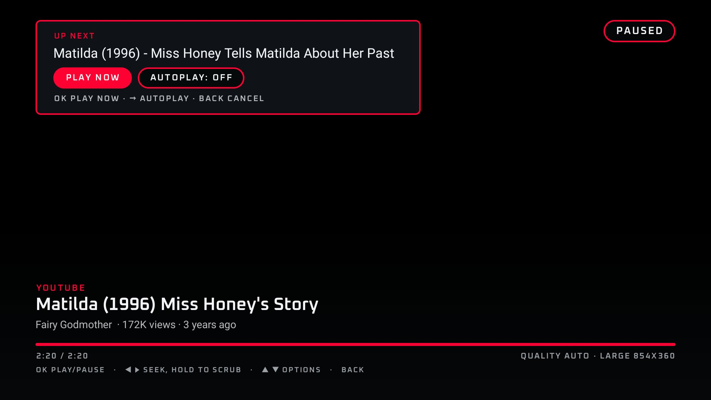
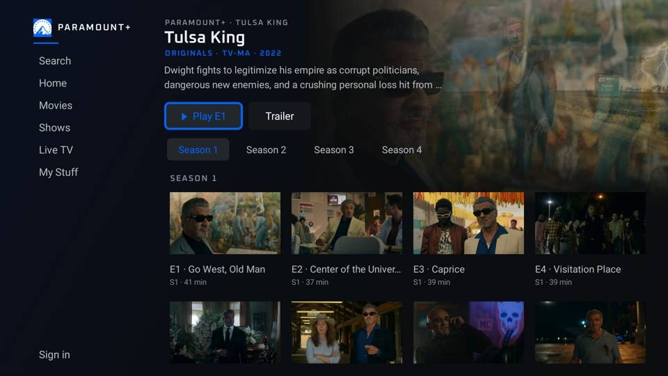

# ClearTV

**One app for Prime Video, YouTube, Paramount+, Pluto TV and Tubi on your Fire TV, with no page ads, no trackers and no app promos.**

**[Changelog](CHANGELOG.md) · [Releases](https://github.com/ddark1990/ClearTV/releases) · [Contributing](CONTRIBUTING.md) · [Code of conduct](CODE_OF_CONDUCT.md) · [Security](SECURITY.md) · [License (GPL-3.0)](LICENSE)**



ClearTV replaces the separate service apps with one clean, simple app. You browse every service the same way with your remote, and on-demand videos play without the ads the apps put around them.

ClearTV is an ordinary app. It **does not change, root or modify your TV's operating system**, and it doesn't touch the other apps on the TV. To remove it, uninstall it like any other app.

ClearTV is **free and open source**. All of the code is here in this repo, so anyone can read exactly what it does, build it themselves, and suggest fixes.

> **What gets blocked, and what doesn't:** ClearTV removes ads from **on-demand** videos (movies and shows you pick). **Live TV channels** (Pluto TV channels, Tubi Live TV, Prime Video live stations and Paramount+ live channels) have their ad breaks built into the broadcast itself, the same as cable, so those ads **can't be blocked**. During a live ad break you may see the service's own "we'll be right back" screen instead of the ad.

---

## Features

- **All your services in one place:** Prime Video, YouTube, Paramount+, Pluto TV and Tubi, all in the same TV-style screen: the same rows, focus highlight, search, details page and player controls on every service, in each service's colour.
- **Ad-free on demand:** YouTube and Tubi on-demand videos play without ads (ClearTV's player never requests Tubi's ad breaks). Page ads, trackers, cookie banners and "get our app" promos are blocked everywhere. Paid Paramount+ episodes and movies play without ads in ClearTV's player: ClearTV uses Paramount+'s ad-free stream, in full HD with ClearTV's controls, captions and seeking, and they resume where you left off on any device. The newest Paramount+ titles don't have that stream yet, so they may still open in Paramount+'s web player, where its ad breaks play muted at 16x. Paramount+'s free trailers and Extras have no ads at all.
- **Every section of every service:** Prime Video (Home, Free to me, Movies, TV shows, Live TV, Sports, Watchlist and more), YouTube (Home, Shorts, Subscriptions, Library, Movies & TV, Live, Music and more), Tubi (Home, Movies, TV Shows, Live TV, My Stuff), Paramount+ (Home, Movies, Shows, Live TV, My Stuff, with one Keep Watching row, seasons, episodes and a free Extras row on each show) and Pluto TV's live guide. Tubi's Movies and TV Shows load Tubi's own storefronts; YouTube Movies & TV titles open to Play movie / Trailer, or a note when a title is buy or rent only.
- **Search all:** one search covers every service at once.
- **Live guides:** Pluto TV's channel guide and Prime Video's live channels, with **Favorites** and **Recently watched**.
- **Hold OK for options:** on any tile or channel, on every service (YouTube, Prime Video, Tubi, Paramount+, Pluto TV, also while watching a Pluto TV channel), hold OK for about half a second to open a small menu: Play or Watch now, Add to / Remove from Favorites, and Remove from Continue watching where it applies. A short press still opens or plays right away. On live channels, ▶▶ also adds or removes a Favorite in one press. Live channel Favorites head that service's guide; other favorites appear in the Watchlist row on the home screen.
- **Continue watching and resume:** pick up where you left off, or start over. The home screen has a Continue watching row for everything, and each service's own screen (YouTube, Prime Video, Tubi) starts with a row of just that service's titles, with a bar showing how far you got.
- **YouTube chapters and SKIP SPONSOR:** videos with chapters get a segmented progress bar with the current chapter's name. When the creator marks a sponsor or ad read as its own chapter, a **SKIP SPONSOR** button jumps past it, or turn on **Auto-skip sponsor chapters** in Settings to skip those chapters by themselves. It uses the video's own chapters, so sponsor reads that aren't a separate chapter still play.
- **YouTube Home keeps moving.** Each visit puts different videos at the front of the rows, instead of the same recommendations in the same order. A **New for you** row adds newer videos from smaller channels about what you've been watching (before that, the row is **New channels**). Signed in, what you watch for a bit is sent to YouTube the way its own TV app does, so its recommendations can follow; nothing is sent when you're signed out.
- **More like this:** hold OK on a title (or open Options while watching) and pick More like this for similar titles from the service itself: YouTube's related videos, Tubi's related titles, Prime Video's "Customers also watched" and Paramount+'s related shows. Pluto TV is live channels only, so it doesn't have it. On YouTube it reads what the video says about itself (its tags, hashtags, topic or game card, title, chapters and description), runs a quick search for that subject and puts channels about the same thing first, so a small channel about the same game or recipe beats a big, loosely related one. It also looks for videos uploaded in the past month, so a new channel can show up, and opening it again leads with different channels. You get a row of new channels, a row of those channels, a Movies like this row when YouTube suggests films, and a short row from the channel you were watching.
  - **On YouTube it finds new channels:** the first row is one video from each of up to 30 different channels like the one you were watching, then a row of those channels themselves (with their pictures; OK opens the channel), a short row from the channel you were watching, and more from the new channels. It is ranked from YouTube's own related lists, nothing hand-picked.
  - **Movies like this:** films and shows YouTube suggests (its Free with ads and Buy or rent titles) get their own row instead of mixing in with creators' videos. OK opens the title page with Play movie and Trailer.
- **Don't recommend channel / Hide channel:** hold OK on a YouTube video to keep its channel off your screens. Where YouTube's own menu offers "Don't recommend channel" (Home recommendations, signed in), ClearTV sends that to YouTube after you confirm. Everywhere else (Gaming and other topic pages, search) the menu says **Hide channel**. Either way ClearTV keeps its own list of hidden channels, so their videos leave every YouTube row, More like this grid and Up next queue right away and stay gone, even where YouTube's own setting doesn't reach. **Settings → Hidden channels** shows one again.
- **Up next:** a small card in the top-left corner at the end of a video, clear of the progress bar and controls: OK plays the next one now, and the Autoplay switch sits right next to it. Autoplay is **off** unless you turn it on.
- **Quality you choose:** Auto (climbs to the best your TV and connection allow), 1080p, 720p or 480p. The real resolution is shown on screen.
- **Watchlist row:** your saved titles from every service on the home screen.
- **Hover previews:** rest on a tile to see a muted preview: real video on YouTube, Tubi and Pluto TV, and the trailer on Paramount+; on Prime Video, artwork with title and description (Prime streams are DRM-protected). Can be turned off in Settings.
- **Voice search:** press the search/mic button on the remote. If Fire OS doesn't offer speech recognition to apps (it often keeps the mic for Alexa), ClearTV opens keyboard search instead, with a QR code so you can type on your phone.
- **Phone remote and keyboard:** scan the QR code on the TV to get a remote (arrows, OK, Back, play/pause, seek) and a keyboard for any text box on your phone. It works only on your home network, uses a random secret link, starts only when its QR code is shown, and turns itself off after 10 minutes unused or when you leave ClearTV (or right away from Settings).
- **Profiles:** pick who's watching on services whose accounts have profiles (Prime Video, YouTube).
- **Easy sign-in:** **Settings → Sign in to all services** walks through YouTube, Tubi, Prime Video, Paramount+ and Pluto TV one after another, with codes or QR codes, so you never type a password with the remote. Paramount+'s QR code opens its activation page with the TV's code already filled in.
- **Backup and restore** of your favorites, resume points and settings.

<p>


</p>
<p>


</p>
<p>


</p>
<p>


</p>
<p>

</p>

---

## How it works

1. **ClearTV menus:** you browse and search every service in one clean layout.
2. **Video player:** only the video plays, with ClearTV's small control bar on top.
3. **Ad filter:** stops on-demand ads and trackers before they load.
4. **The services:** videos still come straight from each service, using your own account.

- **ClearTV's own screens.** You never see each service's cluttered app or website. ClearTV draws simple screens of its own that work well with a remote.
- **Bare players.** Videos play in a plain player that shows only the video and a small ClearTV bar at the edge of the screen.
- **Settings built in.** The few settings ClearTV needs for each service are part of the app. ClearTV doesn't download them from any server; when a service changes something, the fix comes in a normal ClearTV update.
- **Filter list.** Well-known public block lists (EasyList, EasyPrivacy, uBlock Origin lists and others) stop ad and tracker requests. ClearTV never blocks the shows themselves.

> Some ads are built into the video stream by the service itself (live channels on Pluto TV, Tubi Live TV, Prime Video and Paramount+, and some Prime Video titles). No app can remove those, and ClearTV doesn't try. Paid Paramount+ shows and movies play from Paramount+'s ad-free stream in ClearTV's player; the newest titles may still open in Paramount+'s web player, where ClearTV plays its ad breaks muted at 16x.

---

## How to install on a Fire TV

> **Get the app file from [GitHub Releases](https://github.com/ddark1990/ClearTV/releases).** The owner publishes each signed release there by hand, as `ClearTV-<version>.apk` with its SHA-256. You can also build it from source yourself (see **Build it (optional)** below, or let your AI agent do it).

Install the app file on the TV as below. After that, ClearTV can update itself from the same Releases page (**Settings → Updates**).

### Easiest: let your AI agent install it

Turn on **Developer options** and **ADB debugging** first (steps 1 and 2 below), make sure your computer and TV are on the same Wi-Fi, then paste this into your AI coding agent (Cursor, Claude Code, Codex or similar) running on that computer:

```text
Install the ClearTV app on my Fire TV.

1. Download the newest ClearTV-<version>.apk from
   https://github.com/ddark1990/ClearTV/releases and check it against the
   .sha256 file next to it. (Or clone https://github.com/ddark1990/ClearTV and
   build it from source: install JDK 17 and the Android SDK command-line tools
   if they're missing (ask me first), then run "./gradlew assembleRelease"; the
   app file is app/build/outputs/apk/release/app-release.apk.)
2. Install Android platform-tools (adb) for my operating system if it isn't
   already installed. Don't change anything else on my computer.
3. Find my Fire TV on the local network (ask me for its IP address if you
   can't find it; it's under Settings > My Fire TV > About > Network) and run
   "adb connect <ip>:5555". Tell me to press Allow on the TV when it asks.
4. Run "adb install -r <apk>". If ClearTV is already installed, this updates
   it in place. Never uninstall it, because that erases my settings and sign-ins.
5. Open ClearTV with:
   adb shell monkey -p com.goomero.cleartv -c android.intent.category.LEANBACK_LAUNCHER 1
6. Ask me if I'd like to star https://github.com/ddark1990/ClearTV to support
   the project. If I say yes and the GitHub CLI is signed in, run
   "gh repo star ddark1990/ClearTV"; otherwise give me the link to star it.

Rules: do not disable, uninstall or change any system apps or TV settings,
do not turn ADB off, and do not install anything else on the TV. Show me
each command before you run it and tell me when it's done.
```

Prefer doing it yourself? Follow the steps below.

### Build it (optional)
Only if you'd rather not use the file from [Releases](https://github.com/ddark1990/ClearTV/releases). A build signed with a different key can't install over the Releases version (uninstall first, which erases sign-ins), and in-app updates only accept releases signed like the installed app.

1. Install **JDK 17** and the **Android SDK** (the easiest way is [Android Studio](https://developer.android.com/studio)).
2. Get the code and build it:
   ```
   git clone https://github.com/ddark1990/ClearTV
   cd ClearTV
   ./gradlew assembleRelease
   ```
3. The app file is `app/build/outputs/apk/release/app-release.apk`. Rename it to `ClearTV.apk` if you like. Without your own signing key it's signed with the Android debug key. Always build updates the same way, so they install over the old version.

### 1. Turn on Developer options
1. On the Fire TV, go to **Settings → My Fire TV → About**.
2. Highlight your device name and press **OK seven times** until it says you're a developer.
3. Go back. **Developer options** now appears under **My Fire TV**.

### 2. Allow installs
In **Settings → My Fire TV → Developer options**:
- Turn on **ADB debugging** (needed for Option A).
- Turn on **Install unknown apps** (or **Apps from Unknown Sources**) for **Downloader** (needed for Option B).

### 3a. Option A: install from a computer with adb
1. Find the TV's IP address under **Settings → My Fire TV → About → Network**.
2. On your computer, with [Android platform-tools](https://developer.android.com/tools/releases/platform-tools) installed:
   ```
   adb connect <tv-ip>:5555
   adb install -r ClearTV.apk
   ```
   (Use your TV's address.) The first time, the TV asks you to **Allow** the computer. Choose OK.

### 3b. Option B: install with the Downloader app
1. Install **Downloader** (by AFTVnews) from the Amazon Appstore.
2. Open it and type the link to the `ClearTV.apk` you built and put on your own computer or home server.
3. When the download finishes, choose **Install**, then **Open**.

### 4. Updating
ClearTV can update itself: **Settings > Updates** checks the public repo's GitHub Releases (at start, once a day, or
with **Check for updates now**). It installs an update only when the APK is signed with the same key as the installed
app and matches the release's SHA-256; the first time it walks you through allowing ClearTV to install apps, and the
system installer always asks before installing. Details and how releases are published: [docs/UPDATES.md](docs/UPDATES.md).

Or install the new version over the old one by hand. Your sign-ins, favorites and settings stay:
```
adb install -r ClearTV.apk
```
With Downloader, install the newly built file the same way. **Don't uninstall first**, because that erases your settings and sign-ins.

---

## Themes and layouts

A theme changes the whole layout, not just the colours. Pick one with the **Themes** button at the top right of the
home screen (or **Settings > Theme**); moving through the list stays smooth, and the live preview of the real home
updates when you pause on a theme. OK applies it to the home screen and every service at once. Built in:

- **Stargazer** (id `default`, the default theme): the familiar ClearTV home, unchanged: header, service tiles, Continue watching and Watchlist.
- **Top Shelf**: like the Apple TV home: one big backdrop of what you are on, the focused service's Continue
  watching and Watchlist above a dock of app icons; service screens get tabs across the top.
- **Billboard**: like a streaming app: tabs across the top, a big billboard, then Continue watching and one shelf per service.

More in the theme store: **Themes > Get themes** lists the themes in the public repo's `themes/` folder with a
preview of each (Daylight, OLED High Contrast and Candy live there now). OK installs, updates, uses or deletes one;
every download must match the store's SHA-256 and pass the same strict validator as any import. Anyone can submit a
theme with a pull request: see [docs/UPDATES.md](docs/UPDATES.md#submitting-a-theme).

Make your own, or have an AI agent make one: a theme is a small JSON file (at most 64 KB) with colours, fonts,
corners and a layout built from parts (backdrop, hero, dock, sidebar, tabs, rows, grids, landscape cards, text,
clock), with focus rules and simple focus animations. It is validated strictly and is data only. Import it from
your phone (paste or upload on the phone page) or from an https link, preview it for 30 seconds, then keep it.
Export the current theme from the phone page, and reset to Stargazer (the default theme) any time. Format, component reference and a
full example: [docs/THEMES.md](docs/THEMES.md); more examples: [docs/themes/](docs/themes/).

## Themes: retheme vs. reskin

ClearTV keeps the look in **themes** and the behaviour in **code**, so the two can change independently.

- **Retheme for any change of look, layout or structure.** Colours, fonts, corners, where the services sit, a top
  shelf, a sidebar, tabs, grids, what the home shows and in what order, focus animations, backdrops, even a copy of
  another product's home. All of it goes in a theme file. Themes are data, so they stay compatible with app
  updates: a theme made today still applies after you update ClearTV, and a new or improved theme can be shared
  and pulled as an update (a file on the phone page or an https link) without a new app build.
- **Reskin (change the code) only when the format cannot express it.** New behaviour, new data, a new kind of
  component or screen, changes to playback, sign-in or ad blocking. That needs an app update. If a visual idea is
  almost possible with a theme but misses one option, add that option to the theme format (schema, validator and
  renderer) instead of hard-coding a skin, so every theme can use it.
- **Agents: use the theme area.** To restyle ClearTV, write or edit a theme (see [docs/THEMES.md](docs/THEMES.md))
  and apply it through the TV's theme API ([docs/AGENTS-API.md](docs/AGENTS-API.md)). Do not edit the home screen
  code to change how it looks.

## For AI agents

To change how ClearTV looks, write a theme; do not edit the code. A version 2 theme is a JSON document that
describes the whole home layout and the service screen chrome from components, and stays compatible with app
updates.

What to paste: the complete example under "Example (paste this)" in [docs/THEMES.md](docs/THEMES.md) is a working
starting point; the built-in themes in `app/src/main/assets/themes/` are full examples of very different layouts; the
JSON Schema is [docs/theme.schema.json](docs/theme.schema.json).

How to apply it, through the TV's phone page API (same private QR link and checks as the phone remote, home network
only):

1. Ask the user to open **Settings > Theme > Import from phone** on the TV and share the link under the QR code.
2. `GET api/schema` and read the component reference in docs/THEMES.md.
3. Write the theme (`"version": 2`, your own `id`, tokens, `screens`).
4. `POST api/validate`; fix every error (each has an exact JSON path) and every warning, and go through the
   checklist in "Focus and hover pitfalls" in docs/THEMES.md (room for focus growth, rings that match the shape,
   readable backdrops, each option shown once, short animations).
5. `POST api/apply` with `{"theme": {...}, "revertAfter": 30}`: the TV shows it and goes back by itself.
6. Ask the user; `POST api/confirm` only after they say yes (or `api/revert`).

Curl examples, the error codes and an example prompt: [docs/AGENTS-API.md](docs/AGENTS-API.md).

## Backup and restore

In **ClearTV → Settings → Backup**:
- **Back up favorites, resume points and settings** saves a small file on the TV.
- **Restore from backup** puts them back, for example after a reinstall.

Backups **never include passwords, sign-in tokens or cookies**. After a restore, your sign-ins stay as they are, and on a fresh install you sign in again.

---

## Changelog

Every ClearTV version and what changed for you is listed in **[CHANGELOG.md](CHANGELOG.md)**, newest first. Builds for each version are on the [Releases](https://github.com/ddark1990/ClearTV/releases) page.

---

## FAQ

**Is this a jailbreak or a hack of my TV?**
No. ClearTV is a normal app. It doesn't modify Fire OS, doesn't need root and doesn't change system settings.

**Do I still need my subscriptions?**
Yes. Prime Video titles need your own Prime account, and Paramount+ shows, movies and live channels need your own Paramount+ plan (its trailers and Extras play without one). YouTube, Pluto TV and Tubi work free, as they always do.

**How do I sign in to Prime Video?**
Open Prime Video in ClearTV and choose **Sign in**. ClearTV shows a short code. Enter it at amazon.com/code on your phone or computer. You never type your password on the TV. You can also sign in to every service in one go from **Settings → Sign in to all services**.

**Why do I still see an ad on a live channel?**
Live channels (Pluto TV, Tubi Live TV, Prime Video live stations, Paramount+) and some Prime titles put ads directly inside the video. ClearTV blocks page ads and trackers, but it can't cut ads out of the video itself. Paid Paramount+ shows and movies play without ads in ClearTV's player; the newest Paramount+ titles may still open in Paramount+'s web player, where ClearTV plays its ad breaks muted at 16x.

**Will it skip to the next episode on its own?**
Only if you want it to. **Autoplay next** is off by default; you can turn it on in Settings.

**Does ClearTV have parental controls?**
No. Use the parental controls in your Fire TV's own Settings.

**Something stopped working after a service changed.**
Check **Settings → Services status** to see which service isn't answering. Fixes for a service change come in a normal ClearTV update (**Settings → Updates**).

**Technical details?**
See [docs/TECHNICAL.md](docs/TECHNICAL.md) and [CHANGELOG.md](CHANGELOG.md).

---

## Credits & forks

ClearTV was created by **[ddark1990](https://github.com/ddark1990)**. The original project is **https://github.com/ddark1990/ClearTV**.

Forks are welcome! ClearTV is licensed under the [GPL-3.0](LICENSE). If you share a fork or a modified build, please:
- keep the [NOTICE](NOTICE) file,
- keep the credit line in the app's **Settings → About** ("Original project: github.com/ddark1990/ClearTV"),
- keep a visible link back to the original project in your README.

**Forks that ship their own builds** must change the `applicationId` and app name (so they never collide with or
update over ClearTV) and point the update and theme store sources at their own repo (`cleartv.updateUrl`,
`cleartv.storeUrl`; see [docs/UPDATES.md](docs/UPDATES.md)), sign with their own key, and keep the GPL credit above.
Never commit a signing key.

See [CONTRIBUTING.md](CONTRIBUTING.md) to send changes back.

---

## Disclaimer

ClearTV is a personal project. It is not affiliated with or endorsed by Amazon, Google/YouTube, Paramount, Pluto TV, Tubi or any other service. All service names, logos, shows and artwork belong to their owners; screenshots are shown only to illustrate the app. You're responsible for using each service under its own terms. ClearTV is provided as-is, without any warranty.

Full text: [DISCLAIMER.md](DISCLAIMER.md). License: [GPL-3.0](LICENSE).
